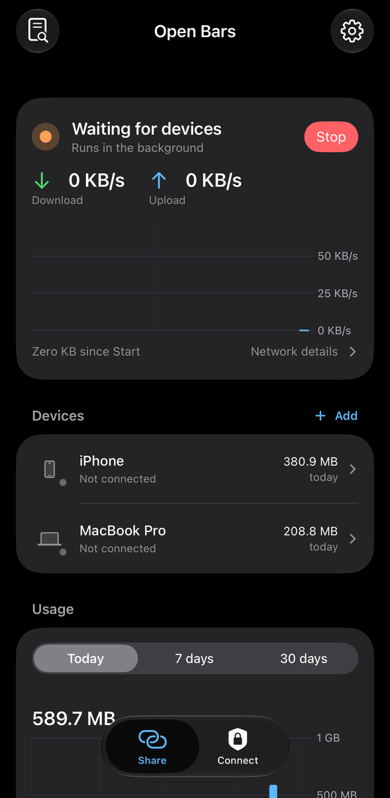
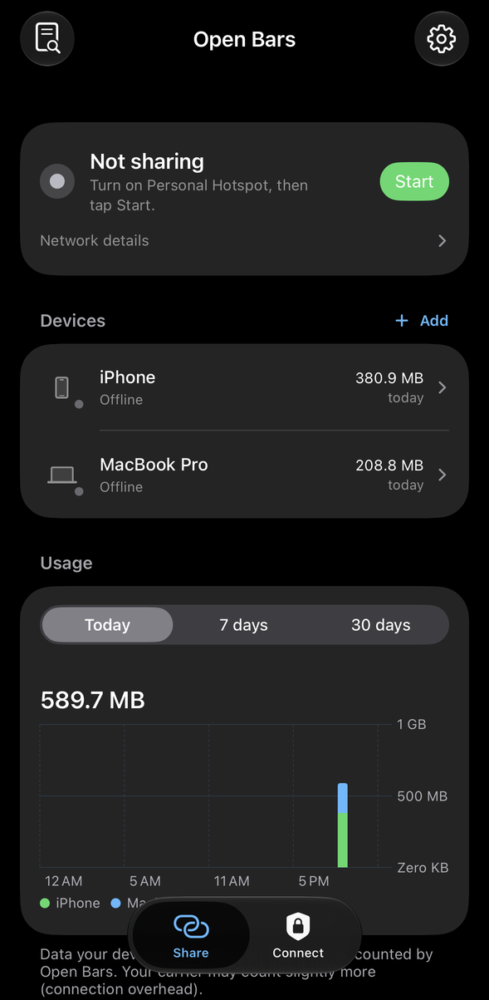
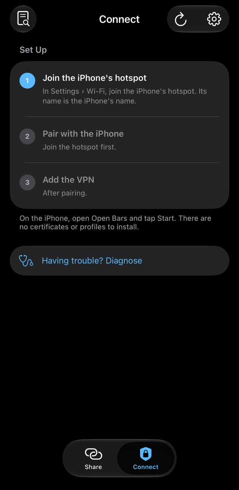

# Open Bars


Open Bars shares an iPhone's cellular connection with your other devices over an encrypted tunnel, using [wireguard-go](https://git.zx2c4.com/wireguard-go). Devices on the iPhone's Personal Hotspot send their traffic into the tunnel, and Open Bars on the iPhone opens each connection from the phone itself.

<p align="center">
  <a href="https://testflight.apple.com/join/Xy7czFXJ"></a>
</p>
<p align="center">
  <b>iPhone, iPad and Mac:</b> <a href="https://testflight.apple.com/join/Xy7czFXJ">join the public beta on TestFlight</a> · <b>Windows:</b> <a href="https://github.com/aayy-dev/OpenBars/releases">download from Releases</a>
</p>

> [!WARNING]
> **Early pre-release.** Hotspot sharing has only been tested on one iPhone so far. Expect rough edges, and please [report anything that doesn't work](#reporting-problems) on yours.

<p align="center">
  
  
  
</p>

One app runs on iPhone, iPad and Mac, and there's a Windows app for PCs:

- **Share** (the iPhone with Personal Hotspot on) runs the tunnel server.
- **Connect** (a Mac, iPad, another iPhone, or a Windows PC on that hotspot) pairs with the iPhone once, then turns its tunnel on whenever the device joins that hotspot and off everywhere else.

Android and Linux devices use the standard WireGuard app with a config from the iPhone. An Open Bars app for Android is [planned](#plans).

Requires iOS 15 or later, macOS 13 or later, and Windows 10 or 11 for the Windows app. Some features need a newer system and are left out on older ones: the speed and usage graphs are simpler on iOS 15, Siri and Shortcuts actions need iOS 16, and Control Center controls and widgets need iOS 18.

## Install

**iPhone, iPad and Mac: [join the public beta on TestFlight](https://testflight.apple.com/join/Xy7czFXJ).** Open the link on the device, install TestFlight if asked, then install Open Bars from it. This is the easiest way, and it has every feature. The Mac app needs macOS 13 or later.

**Windows:** download it from [Releases](https://github.com/aayy-dev/OpenBars/releases) (see [Windows](#windows) below).

Unsigned builds of everything are on the [Releases](https://github.com/aayy-dev/OpenBars/releases) page too:

| File | For |
| --- | --- |
| `OpenBars-<version>.ipa` | iPhone and iPad, sideloaded |
| `OpenBars-<version>-macOS.zip` | Mac (pairs, but can't connect; see below) |
| `OpenBars-windows-x64-<version>.exe` | Windows PCs (`-arm64-` for ARM PCs) |
| `OpenBars-windows-x64-<version>.zip` | The same Windows app as separate files (extract them all first) |

None of them are signed, so you sign the iPhone and Mac apps yourself.

**Signing them yourself doesn't get every feature.** Background sharing, the Connect VPN, and the Control Center controls and widgets need the Network Extension and App Groups capabilities. Those require a paid Apple Developer account and an App ID registered for this app (see [Building](#building)). TestFlight has them all.

### iPhone and iPad: sideloading (e.g. Feather)

1. On the release, long-press `OpenBars-<version>.ipa` (CI builds are `OpenBars-<version>-build<N>.ipa`) and copy the link.
2. In [Feather](https://github.com/khcrysalis/Feather): **Library › + › Import from URL**, paste the link, then sign it with your certificate and install.

What works when sideloaded depends on your certificate's provisioning profile. Profiles from signing services are usually shared by many apps, so they can't carry those capabilities. On such a certificate, expect:

- **Works:** sharing while Open Bars is open, pairing requests, adding WireGuard-app devices, usage history, the Personal Hotspot shortcut.
- **Doesn't work:** **Keep sharing in the background**, along with the Control Center, widget, Siri and Shortcuts actions that rely on it, and the **Connect** tab's VPN (use the WireGuard app on the connecting device instead). Controls and widgets also can't show whether sharing is on.

### Mac

Install it from [TestFlight](https://testflight.apple.com/join/Xy7czFXJ), or build it with Xcode (see [Building](#building)). macOS allows a VPN app extension only in App Store and TestFlight builds and in builds signed with a development profile, so the release's unsigned Mac app can't add the VPN.

`OpenBars-<version>-macOS.zip` is included for completeness. To open it, run `xattr -dr com.apple.quarantine "Open Bars.app"` and `codesign --force --deep --sign - "Open Bars.app"`. It can pair, but not connect. Without a developer account, use the WireGuard app for Mac with a config from the iPhone (see **Other devices** under [Using it](#using-it)).

### Windows

Download `OpenBars-windows-x64-<version>.exe` (or `OpenBars-windows-arm64-<version>.exe` on an ARM PC) and run it. It offers to install itself (administrator prompt): it goes to `C:\Program Files\Open Bars` with a small background service that runs the tunnel, a Start menu entry and a tray icon. The builds aren't code-signed yet, so SmartScreen may ask first (**More info › Run anyway**). Remove it from **Settings › Apps**. See [windows/README.md](windows/README.md) for details.

## Using it

The first time you open Open Bars on an iPhone or iPad, it asks whether that device shares or uses another iPhone's data. Until the first device is added, the Share tab shows the steps, ticking each one off as it's done, and **Add** walks through setting up each kind of device.

**On the iPhone that shares**

1. Turn on Personal Hotspot, open Open Bars and tap **Start**. Allow Local Network access when asked.
2. By default sharing runs inside the app, so keep it on screen (the display stays awake while sharing). It keeps going for a short time after you switch away (iOS allows about 30 seconds), then pauses and sends a notification. To lock the iPhone or switch apps, turn on **Settings › Keep sharing in the background**. Sharing then runs as a system VPN component that iOS keeps alive. It carries none of the iPhone's own traffic, but iOS runs one VPN at a time, so the iPhone can't use another VPN app while sharing this way.
3. Optional: **Settings › Personal Hotspot**. Apps can't switch on Personal Hotspot, but Shortcuts can. Add the "Open Bars Hotspot" shortcut from there, and Start turns the hotspot on too (Open Bars hops to Shortcuts for a moment and back).

Other ways to start and stop (iOS 18 or later):

- **Control Center:** **Open Bars Sharing** turns sharing on or off without opening the app (it runs in the background). **Open Bars + Hotspot** turns the hotspot and sharing on together, or off together, opening Open Bars for a moment. Both are highlighted while sharing.
- **Widgets, Siri and Shortcuts:** a Home Screen widget, and the actions **Start Sharing**, **Stop Sharing** and **Share with Hotspot**.

**Data limits and notifications**

- **Limits:** on a device's page, set how much data it can use per hour, day, week or month, or in total, and pause its internet at any time. **Settings › Data Limits** sets what happens when a limit is reached (block, slow down or only notify), a limit for newly allowed devices, and a limit for all devices together with your billing day. You can also choose a limit when you tap Allow.
- **Asking for more:** a connected device can open `http://10.66.66.1` to see its own usage and limits and ask for more time or data. You approve or decline on the iPhone, from the Share tab or the notification.
- **Removing a device keeps its record:** when it pairs again with the same key, its limits and usage carry on.
- **Notifications** (mostly with background sharing): a device asking to connect, a device near or at a limit, a request for more, sharing stopping by itself (including when iOS ends background sharing without warning), and problems. You can answer from the notification (Allow, Give More, Approve), and turn each kind off in Settings.
- **The limitation:** limits count what goes through Open Bars. A device that knows your hotspot password can turn its VPN off and use Personal Hotspot directly, which Open Bars can't see or limit.

**On a Mac, iPad or iPhone that connects**

1. Join the iPhone's hotspot and open Open Bars › **Connect**.
2. Tap **Pair with iPhone**, then **Allow** on the iPhone. The device makes its own key pair; only the public key goes to the iPhone.
3. Approve adding the VPN configuration. From then on the "Open Bars" VPN connects by itself on that hotspot and stays off on other networks. On a Mac it also connects over a USB cable. **Diagnose** walks through each step if something doesn't work.

On a Mac, Open Bars lives in the menu bar once it's set up. **Settings › Menu Bar & Dock** chooses where it shows.

**On a Windows PC**

1. Join the iPhone's hotspot (Wi‑Fi or USB) and open Open Bars from the tray or the Start menu.
2. Click **Pair with iPhone**, then **Allow** on the iPhone.
3. That's it: the tunnel turns on by itself whenever the PC is on that hotspot. The tray icon shows the state (green bars when connected), and **Diagnose** checks each link if something doesn't work.

**Other devices (WireGuard app)**

In Share, tap **Add › Something else**, create the device, then scan its QR code with the WireGuard app. On a laptop, open `http://172.20.10.1:8080` while on the hotspot and download its `.conf`. The page offers each config once, within 15 minutes of adding the device (or tapping **Allow Download** on it), so nobody else on the hotspot can take its key.

## Privacy

Open Bars collects no data: there are no accounts, analytics or Open Bars servers, and nothing is sent to the developer. Device names, keys, usage and logs stay on your devices. Your devices' DNS lookups go to the servers in Settings › Tunnel (Cloudflare and Google by default). The details are in the [privacy policy](PRIVACY.md).

## FAQ

**Does Open Bars save data or get around my carrier's hotspot limits?**
It doesn't reduce the data you use. Your devices' traffic still goes over your iPhone's cellular connection and counts against your plan. Open Bars sends it out as the iPhone's own traffic, so whether your carrier counts it as hotspot use is up to the carrier. Plans differ on what's allowed for data used by other devices, so check your plan's terms.

**Can the developer see my traffic?**
No. Traffic goes from your devices to your iPhone and from there straight to the internet. There's no Open Bars server in between.

**Do I need the WireGuard app?**
Not on a Mac, iPad, iPhone or Windows PC: they pair with Open Bars directly. Other devices, such as Linux computers or other phones, use the WireGuard app with a config from the iPhone.

**Can the iPhone use another VPN app while it shares?**
Only while sharing runs in the app. Then the hotspot devices' traffic goes through that VPN too. With **Keep sharing in the background** on, Open Bars is the iPhone's VPN, and iOS runs one VPN at a time.

**Why does Windows warn when I run it?**
The Windows build isn't code-signed yet, so SmartScreen doesn't recognize it. Choose **More info › Run anyway**. The source and build script are in [`windows/`](windows).

## Reporting problems

[Open an issue](https://github.com/aayy-dev/OpenBars/issues/new/choose) with the bug report form. On the device that connects, run **Diagnose** and include what it says. Then turn on **Detailed logging** in the log, reproduce the problem and attach the exported log. Logs never contain private keys, but they do include device names and addresses, so look them over first.

## How it works

- The iPhone runs [wireguard-go](https://git.zx2c4.com/wireguard-go) with a userspace TCP/IP stack ([gVisor](https://gvisor.dev)) instead of a network interface. Each TCP connection and UDP flow from a device is answered locally and opened again from a socket on the iPhone, pinned to the cellular interface. If a VPN app is running on the iPhone (in-app sharing only), traffic follows that VPN instead.
- On IPv6-only carriers, IPv4 destinations are reached through the carrier's NAT64.
- Each device gets an IPv4 and an IPv6 address inside the tunnel, and its DNS goes to the iPhone, so none of its traffic leaves through the hotspot directly.
- Background sharing is a packet tunnel extension with no routes: it only keeps the server running while the app is closed.
- Connect is a Network Extension packet tunnel running wireguard-go, with on-demand rules matching the hotspot's Wi‑Fi name (the iPhone's name).
- Pairing is a small HTTP API on the iPhone (`/api/pair`), answered only after someone taps Allow there. A request stays open for 10 minutes, so it can be allowed later from a notification.
- Data limits are decided every second from WireGuard's per-device byte counters and applied to the device's packets: blocked devices can only reach the status page, slowed ones go through a token bucket. The status page (`http://10.66.66.1`) is served inside the userspace stack, so a request's source is the device's tunnel address, which WireGuard ties to its key.

## Building

The Windows app builds from macOS or Linux with Go alone: `windows/build.sh <version>` (see [windows/README.md](windows/README.md)). The rest of this section is the iPhone/iPad/Mac app.

Requirements: macOS with Xcode 26 or later, Go (see `ios-app/core/go.mod`), [gomobile](https://pkg.go.dev/golang.org/x/mobile/cmd/gomobile), [XcodeGen](https://github.com/yonaskolb/XcodeGen) and a paid Apple Developer account (Network Extensions need one).

```sh
go install golang.org/x/mobile/cmd/gomobile@latest golang.org/x/mobile/cmd/gobind@latest
gomobile init

cd ios-app/core
gomobile bind -target=ios,iossimulator -iosversion=15.0 -ldflags="-s -w" \
  -o ../OpenBars/Frameworks/WGCore.xcframework ./wgcore
gomobile bind -target=ios,iossimulator,macos -iosversion=15.0 -macosversion=13.0 -ldflags="-s -w" \
  -o ../OpenBars/Frameworks/WGClient.xcframework ./wgclient
```

Bundle IDs and the app group (`dev.aayy.openbars…`, `group.dev.aayy.openbars`) belong to one developer team, so use your own prefix:

```sh
cd ios-app
grep -rlI 'dev\.aayy' OpenBars tools --exclude-dir=OpenBars.xcodeproj --exclude-dir=Frameworks \
  | xargs sed -i '' 's/dev\.aayy/com.yourname/g'
```

If you want the bundled "Share with Open Bars" shortcut, regenerate it for your bundle ID and team with `tools/make_shortcuts.py`, then sign it with `shortcuts sign --mode anyone`.

Then:

```sh
cd OpenBars
xcodegen generate
open OpenBars.xcodeproj
```

In Xcode, set your team on the `OpenBars` and `OpenBarsMac` targets and their extensions, then build and run on your devices. Xcode registers the App IDs. If signing fails on the app group, register `group.<your prefix>.openbars` under Certificates, Identifiers & Profiles and enable it on the app, `.tunnel` and `.widgets` IDs. The engine's tests run with `go test ./...` in `ios-app/core`.

The GitHub Actions workflow (`.github/workflows/ios-app.yml`) builds an unsigned `.ipa` on each push.

## Layout

| Path | What |
| --- | --- |
| `ios-app/OpenBars/Sources` | iPhone app and Share tab |
| `ios-app/OpenBars/Client` | Connect tab (shared by iOS and macOS) |
| `ios-app/OpenBars/Shared` | Sharing state, App Intents and tunnel control (shared with the extensions) |
| `ios-app/OpenBars/Connect` | Connect's tunnel extension (wireguard-go) |
| `ios-app/OpenBars/Tunnel` | Background-sharing extension (no routes) |
| `ios-app/OpenBars/Widgets` | Control Center controls and Home Screen widgets |
| `ios-app/OpenBars/Mac` | Mac app (window and menu bar) |
| `ios-app/OpenBars/Resources` | App icon (`AppIcon.icon` for iOS/macOS 26+, PNGs for older) and `Licenses.json` |
| `ios-app/core/engine` | The sharing server (wireguard-go, TCP/UDP forwarding, DNS, pairing, usage, config page) |
| `ios-app/core/wgcore`, `wgclient` | gomobile APIs for the iPhone app and the Connect extension |
| `ios-app/tools` | Icon, shortcut and license-list generators, and the App Store screenshots (`screenshots/make.sh`) |
| `windows` | Open Bars Connect for Windows (Go: service, tray app, installer; see its README) |
| `docs` | README images and [App Store Connect text](docs/app-store-connect.md) |

## Known limits

- Some carriers still cap upload speed for the whole phone while any device is on the hotspot. Open Bars can't change that.
- Pairing needs Open Bars open on the iPhone, so someone can tap Allow.
- Turning on Personal Hotspot goes through Shortcuts, so Open Bars briefly switches to Shortcuts and back.

## Plans

- **Connect for Android:** a small Open Bars app that pairs with the iPhone the same way (tap Allow on the iPhone) and turns the tunnel on by itself on its hotspot, like Connect on Apple devices and Windows. Until then, Android devices use the WireGuard app.
- **Sharing from Android:** exploring whether the Share side can run on an Android phone too, so its mobile data can be shared the same way.

## License

Open Bars is released under the [MIT License](LICENSE).

The app lists the open-source software it ships with (wireguard-go, gVisor, Go and the `golang.org/x` packages) and their licenses under **Settings › About › Open-Source Licenses**. After changing `ios-app/core/go.mod`, regenerate that list with `python3 ios-app/tools/make_licenses.py`.

"WireGuard" and the "WireGuard" logo are registered trademarks of Jason A. Donenfeld.
